  

  

  

  

### Selected work

- **[NatureMaps](https://github.com/huugok/NatureMaps-Frontend)** — interactive map for plants, parks and green areas. TypeScript + Next.js front end, FastAPI/PostgreSQL back end.
- **[MindCheck](https://github.com/huugok/MindCheck)** — AI tooling for enterprise problem solving, built for the NTT Data × UPV hackathon.
- **[competitive-programing](https://github.com/huugok/competitive-programing)** — CSES and Codeforces solutions in C++.

  

